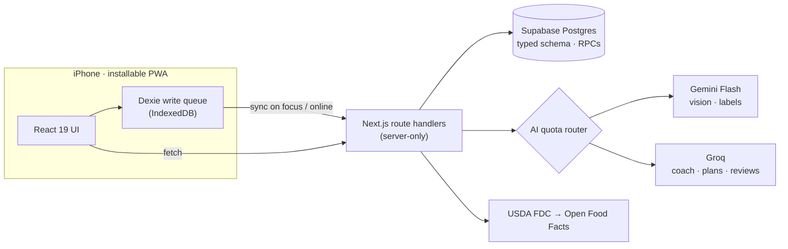

<div align="center">


# Coachienta

**A food and training log with an AI coach. It works offline, it is built for one person, and its schema is designed so the old spreadsheet's mistakes cannot happen.**


</div>

---

## Why it exists

I tracked food and training in a 20-tab spreadsheet. It held about 36,000 cells, and at some point I stopped being able to trust it. An audit found these problems:

- The nutrition dashboard showed **0 kcal for every day** because the dates were stored as text.
- Six tabs gave **six different calorie targets**, and four training phases were all marked "Active".
- The AI coach prompt used a bodyweight that was **6 kg out of date**, and it calculated every calorie figure from that number.
- The three newest workouts were in a tab that **no formula referenced**, and 44 of its 77 rows were shifted one column.

Each of these is a type of bug that a typed database can rule out completely. Coachienta does that, and it adds an offline-first phone app plus an AI coach that answers from SQL instead of from text pasted into a prompt.

> I am the only user, there is no login, and I use it every day.

## What it does

| | |
|---|---|
| 🍱 **Food logging** | Search a personal library, USDA, and Open Food Facts. Log from a **photo of a plate or a nutrition label** (Japanese labels included), or paste a meal as text. Logging a food you ate before takes two taps. |
| 🏋️ **Training** | Exercise library, 4-day templates, an AI plan builder, and live set logging with a rest timer. PRs are tracked **per set position and per gym**, and progression suggestions come from your own history. |
| 📈 **Trends** | Weekly averages, per-muscle volume, strength curves, and a TDEE estimated from intake and the scale. |
| 🎯 **Profile & goals** | Targets, phases, and coach rules that take effect from a date. A body log. A calorie floor that the API enforces as well as the form. |
| 🤖 **Coach** | A chat agent with read-only SQL tools. It looks up facts live, so it never works from a stale snapshot. It also reviews each finished session. |

## Engineering highlights

These are the decisions most worth talking through. Each one is documented with the evidence that led to it in [`AGENTS.md`](AGENTS.md).

**The schema prevents the spreadsheet's bugs.** Dates use a `date` column. "One active target" and "one active phase" are partial unique indexes. `is_pr` is a boolean, not free text. Volume is calculated only for load types where it means something: `computeVolume` returns `null` for assisted, timed and bodyweight work, so a plank can't outweigh a squat.

**Writes are local-first and idempotent.** Every write goes to an IndexedDB queue (Dexie) first and syncs when the app regains focus or comes back online. The browser generates each row's uuid, and that uuid is the primary key, so replaying the queue upserts rows instead of duplicating them. Logging a set takes under **200 ms with no connection**. That figure is measured inside the page with a `MutationObserver`, because a timer running in Node mostly measures Playwright.

**There is no auth and no database key in the browser.** With a single user and no row-level security, any key shipped to the client would give anyone full read/write access to the database. All data goes through `app/api/data/*`, and `lib/{db,ai,env,nutrition}` are `server-only`: if a client component imports one of them, the build fails.

**The model reads the label and code does the maths.** One vision call sorts a photo into `plate`, `label` or `neither`. On the label path the model only transcribes the panel. All arithmetic is plain, tested TypeScript, and that's where the subtle cases live:
- On Japanese labels, 糖質 means net carbs, not sugars.
- Legal rounding rules mean a percentage-based Atwater check would reject valid labels. The validator instead checks whether the printed kcal falls inside the range the printed macros allow.

**AI never blocks logging.** A quota router tracks free-tier budgets for each provider, including Gemini's limit of 20 requests a day. Quotas reset on the provider's timezone. When a budget runs out, the router degrades instead of failing. It never shows a raw provider error to the user. Measuring tokens turned up an SDK detail: `onFinish.usage` counts only the final step of a multi-step turn, which had been undercounting usage by about half.

**History is immutable.** Correcting a food's macros bumps `foods.version`. Entries already logged keep the macros they were saved with, so last month's charts never change on their own. Targets and phases are never edited in place. A Postgres RPC closes the old row and opens the new one in a single transaction.

**PRs are compared by set position.** Set 3 is compared only with earlier set 3s. When every set of an exercise goes into one pool, only the top set can ever set a record, which hides most of the progress from a program that ramps weight up across sets. Set position is counted among working sets only, so adding a warm-up doesn't shift your history.

## Architecture



```
app/api/data/*        the only path to the database
lib/schemas/          Zod: the single source of truth for types, mirrors Postgres enums 1:1
lib/domain/           pure functions, no I/O (macros, volume, energy, PRs, dates)
lib/ai/               model registry, providers, quota router, coach tools
lib/offline/          Dexie mirror + sync queue
hooks/                all state and effects; components get a flat view-model
components/ui/        Tier 0 primitives, no domain knowledge
components/patterns/  Tier 1 composites, still domain-agnostic
components/<feature>/ Tier 2, domain-aware
```

Dependencies go in one direction only, from Tier 2 to Tier 1 to Tier 0 to tokens. Components contain JSX and one hook call. They don't use `useEffect`, call `fetch`, or do arithmetic.

## Tech stack

| Layer | Choice |
|---|---|
| Framework | Next.js 16 (App Router, Turbopack in dev), React 19, TypeScript `strict` + `noUncheckedIndexedAccess` |
| Data | Supabase Postgres, SQL migrations, Postgres RPCs for atomic multi-row writes |
| Client state | TanStack Query, Dexie (IndexedDB) for the offline mirror and write queue |
| Validation | Zod 4, also used to generate the JSON schema embedded in model prompts |
| AI | Vercel AI SDK 7, Gemini Flash (vision), Groq (chat, tool calls) |
| Nutrition | USDA FoodData Central, Open Food Facts |
| UI | Tailwind 4, Radix primitives, a custom 3-tier design system ("Instrument": mono numerals, hairline rules, safety-orange accent) |
| PWA | Serwist service worker, installable on iOS |
| Testing | Vitest (pure domain logic), Playwright E2E against a real Postgres database |
| Hosting | Vercel, functions pinned to Tokyo to sit next to the database |

## Testing

- **514 unit tests** for the pure domain logic: macros, label arithmetic, volume, PR detection, progression, and date math.
- **128 Playwright E2E tests** that run against **real Postgres** rather than mocks. They cover offline-to-sync replay, the latency budget, and the claim that correcting a food never rewrites history.
- The database holds real data, so every test fixture is scoped to a sentinel date in 2019, a `ZZTest` name, or an id the test created itself. No cleanup query can match one of my real rows.
- A CI assertion can't judge model quality, so there are **probe scripts** for a human to read real model output: `npm run probe:vision <photo>`, `probe:plan`, and `probe:coach`.

## Documentation

The product was specified before it was built. [`docs/`](docs/README.md) holds nine PRDs: product, technology, design research (13 apps reviewed), the design system, one per feature, and credentials. Each feature PRD tracks its acceptance criteria as ✅ / ⚠️ / ❌, and anything still open is named.

[`AGENTS.md`](AGENTS.md) is the engineering log. Each entry is a fact that took real time to discover, with the evidence and the fix.

## Running it locally

```bash
npm install
cp .env.example .env.local     # see docs/PRD-008-credentials-setup.md for each key
npm run migrate                # idempotent; safe to re-run
npm run dev
```

Unlock the device once at `/unlock`, or open `/?k=$APP_ACCESS_TOKEN`. This sets a one-year cookie. It works like a doorbell, not a login: there is no account and no password.

```bash
npm run build        # uses --webpack: Serwist's config only applies in this phase
npm run typecheck
npm test             # vitest
npm run test:e2e     # playwright against real Postgres; cleans up after itself
npm run sweep        # drives every flow in a browser and reports console errors
```

<details>
<summary><b>Deploying (Vercel)</b></summary>

1. Import the repo at [vercel.com/new](https://vercel.com/new). Next.js is detected automatically, and `npm run build` already passes `--webpack`.
2. Add **every** variable from `.env.example` for Production, Preview and Development. The app throws at boot if a value is missing or malformed (`lib/env.ts`), so it never starts half-configured.
3. Deploy, then open `https://<your-app>/?k=$APP_ACCESS_TOKEN` once on each device.

Migrations run against the same Supabase project in every environment, so `npm run migrate` from your machine updates production.

- **`APP_ACCESS_TOKEN` must be URL-safe hex** (`openssl rand -hex 32`). In a base64 token, a `+` decodes to a space inside `?k=`.
- **`vercel.json` pins functions to `hnd1`** because Supabase runs in `ap-northeast-1`. A US region would add a trip across the Pacific to every query.
- **If a secret ever lands in a commit, rotate it.** Removing it in a later commit does not remove it from git history.

</details>

## Status

| | |
|---|---|
| **Shipped** | Food logging with photo, label and paste input · training log with PRs, progression and trends · profile, goals and coach rules · AI plan builder · AI coach with SQL tools and session reviews · TDEE report |
| **Not built yet** | Vector search over logged days, coach feedback, saved conversations |
| **Known gap** | Reloading the app while offline (the service worker precaches only static assets). Queued writes are not affected. |
